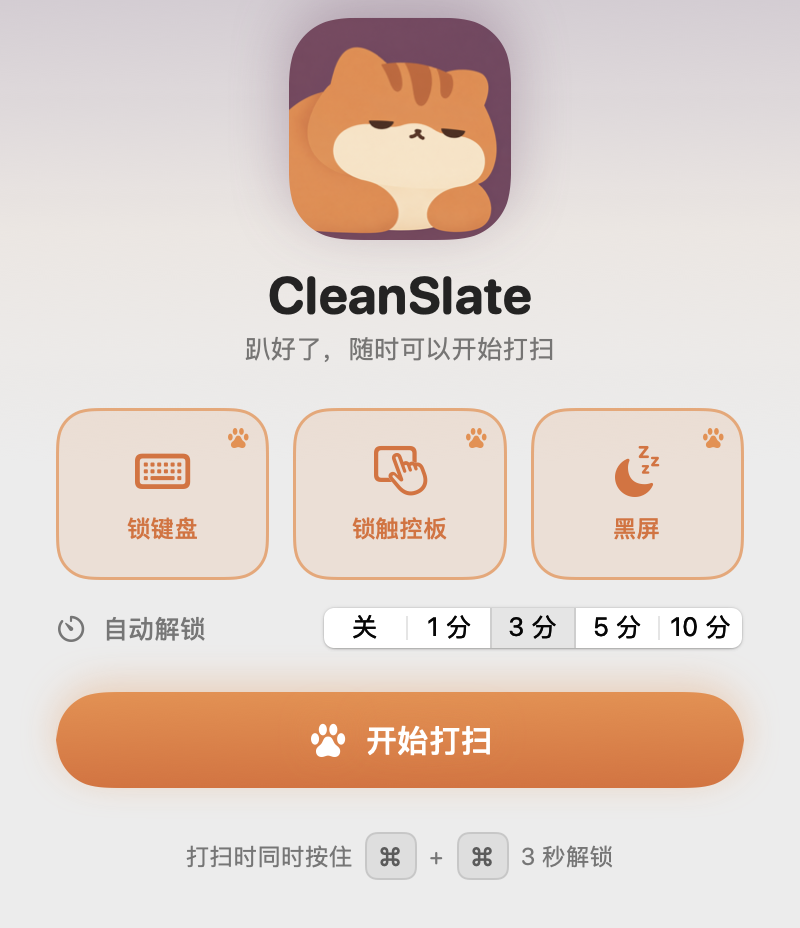
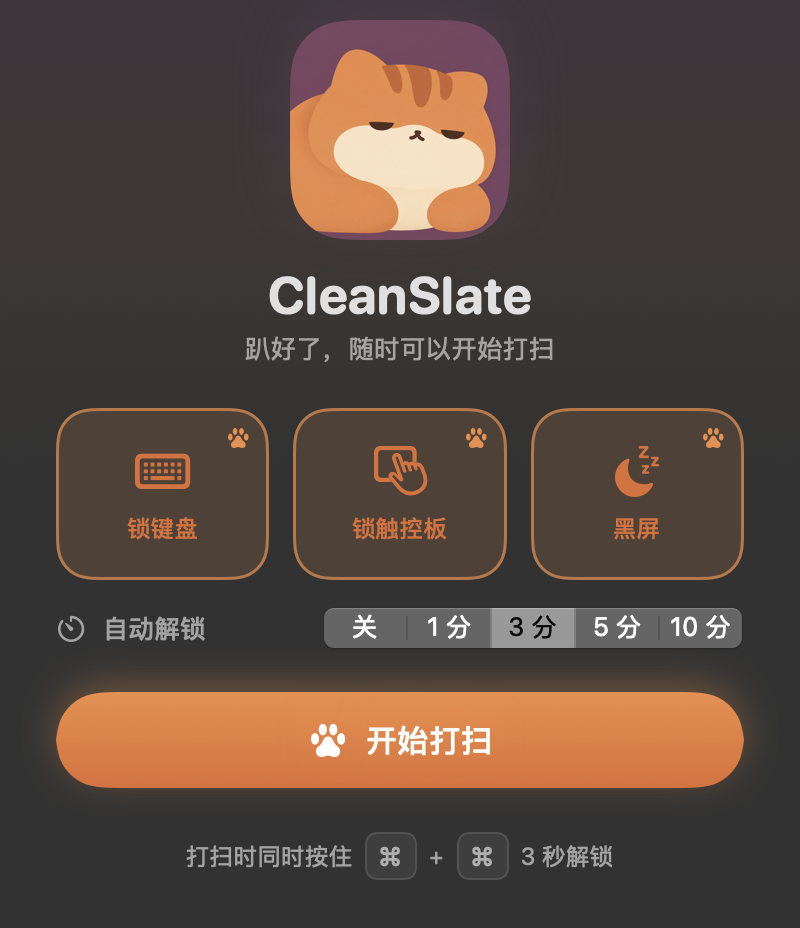

<div align="center">


# CleanSlate

**一键锁住键盘和触控板，屏幕全黑，安心擦电脑。**

小橘帮你看着键盘，同时按住左右两个 ⌘ 3 秒解锁。

[English](#english)

</div>

<p align="center">
  
  
</p>

## 功能

- **锁键盘**：拦截所有按键，包括音量、亮度等媒体键，擦键盘时不会误触
- **锁触控板 / 鼠标**：拦截点击、移动和滚动，并隐藏光标
- **黑屏**：所有显示器盖上纯黑画面，灰尘和指纹一目了然
- **双 ⌘ 解锁**：同时按住左右两个 Command 键 3 秒，爪印圆环转满即解锁
- **自动解锁兜底**：可设 1 / 3 / 5 / 10 分钟后自动解锁，万一按键失灵也不会被锁在外面

三个选项可以任意组合，比如只开黑屏来擦屏幕。

## 安装

需要 macOS 13 或更高版本，以及 Xcode 或 Command Line Tools（`xcode-select --install`）。

```bash
git clone https://github.com/SEUWanglibo/CleanSlate.git
cd CleanSlate
./build-app.sh --install   # 编译、打包并安装到 /Applications
```

只想打包、不安装的话，运行 `./build-app.sh`，产物在 `build/CleanSlate.app`。

### 授予辅助功能权限

锁定键盘和触控板需要「辅助功能」权限：首次打开点「去授权」，然后在 **系统设置 → 隐私与安全性 → 辅助功能** 里打开 CleanSlate。

> 应用使用 ad-hoc 签名，重新编译后签名会变，可能需要在辅助功能列表里删掉旧条目再重新授权。

## 使用建议

第一次使用时**先只开「黑屏」**，确认双 ⌘ 能正常解锁，再打开键盘和触控板锁定。

## 实现原理

- 在 HID 层创建 `CGEventTap` 拦截所有输入事件，按设置决定吞掉还是放行；系统因超时停用 tap 时会立即重新启用
- 通过修饰键事件里的设备相关标志位（`NX_DEVICELCMDKEYMASK` / `NX_DEVICERCMDKEYMASK`）判断左右 ⌘ 是否同时按下
- 黑屏是每块屏幕上一个 `CGShieldingWindowLevel` 层级的无边框纯黑窗口
- 界面用 SwiftUI 编写，用 Swift Package Manager 构建，不依赖 Xcode 工程

```
Sources/CleanSlate/
├── CleanSlateApp.swift      # 入口和主界面
├── CleanupController.swift  # 开始 / 结束打扫、解锁计时、权限
├── EventTap.swift           # 全局输入拦截
├── BlackoutOverlay.swift    # 黑屏窗口
├── Theme.swift              # 配色和组件样式
└── Snapshot.swift           # 开发用：--snapshot 离屏渲染界面
```

## 致谢

- 灵感来自 [CleanupBuddy](https://cleanupbuddy.app)。CleanSlate 是独立实现，与它没有关联，也没有使用它的代码或素材。
- 图标里的小橘是用 AI 图像模型生成的原创形象，生成时参考了 [ip-as-logo](https://github.com/s1dashu/ip-as-logo-skill) 的风格规范。用 `scripts/make-icon.py` 可以从 `Resources/MascotSource.png` 重新生成图标。

## 许可

[MIT](LICENSE)

---

<a id="english"></a>

## English

**CleanSlate** is a tiny macOS utility for cleaning your Mac: it locks the keyboard and trackpad and can black out every display, so you can wipe keys and the screen without triggering anything. Hold **both ⌘ keys for 3 seconds** to unlock; an optional auto-unlock timer keeps you from getting locked out.

Build and install (macOS 13+, Xcode or Command Line Tools):

```bash
./build-app.sh --install
```

Then grant Accessibility permission in **System Settings → Privacy & Security → Accessibility**. Licensed under MIT.
